# DSH Self-Use Index

> **Languages:** English · [简体中文](README_ZH.md)

This repository is an **index** for a set of self-use development projects built on top of
[DeepSeek Harness (DSH)](https://github.com/deepseek-ai/deepseek-harness) — an all-plugin
Cordis agent harness. It does **not** contain the source of any sub-project; instead it
points to each sub-project's own repository so they can be developed and versioned
independently.

## Purpose

- Serve as a single entry point for all personal DSH-related development work.
- Keep an up-to-date catalog of sub-projects with links and short descriptions.
- Track project-level documents (under `docs/`) that span multiple sub-projects.

## Architecture

The desktop pet is the user-facing entry point. It talks to the DSH core over HTTP/SSE
through the `dsh-web-service` session API. The DSH core is an all-plugin Cordis harness —
every capability (including the agent loop) is a plugin. The diagram below reflects the
**actually-enabled plugins** in the `web` profile (`~/.dsh/profiles/web/`), plus the
reference-only / superseded plugins kept under `_plugin-references/`.

```mermaid
flowchart LR
    Pet["Desktop Pet Front-end<br/>dsh-pet-chubby_blue_whale<br/>(PySide6, Python 3.14+)<br/>visual interaction only"]

    subgraph Core ["DSH Core — deepseek-harness (Cordis all-plugin)"]
        direction TB
        Web["dsh-web-service<br/>(dsh-webapi) REST API gateway<br/>pet entry point"]
        AgentLoop["agent-loop<br/>(plugin, not privileged)"]
    end

    subgraph SelfDev ["Self-developed plugins (independent repos)"]
        direction TB
        PetMemory["@dsh-cbw/memory<br/>memory backend<br/>(derived from fish-memory:<br/>scoring + half-life + P0-P3 upgrades)"]
    end

    subgraph Inherited ["Inherited plugins (from MerZlin/dsh-pet-indesktop)"]
        direction TB
        PetBridge["@dsh-pet/bridge<br/>pet state bridge<br/>(screen / window sync)"]
    end

    subgraph InUse ["Third-party plugins in use (web profile)"]
        direction TB
        Persona["dsh-persona-dafeiyu<br/>persona injection<br/>(systemPrompt.section, v0.7.1)"]
        Balance["@wycto/dsh-balance-panel<br/>balance query"]
        Bili["dsh-bili-scroll<br/>Bilibili scroll duty"]
        ChatMgr["dsh-chat-manager<br/>session management"]
        Skills["@michengai/dsh-skills-manager<br/>skill management"]
        Reason["dsh-custom-reasoning<br/>custom reasoning"]
        CompUse["dsh-codex-style-computer-use<br/>GUI operation"]
        BigCtx["billion-context<br/>long context / storage"]
        Univer["dsh-univer-office<br/>Univer office"]
        Preset["dsh-preset-bridge<br/>preset bridge"]
        ModSearch["@liustack/modsearch<br/>module search"]
        Safety["cc-safety-net<br/>safety net"]
        Market["dshmarket<br/>plugin marketplace"]
    end

    subgraph RefOnly ["Reference-only / superseded (in _plugin-references, NOT enabled)"]
        direction TB
        FishMem["dsh-fish-memory<br/>→ superseded by @dsh-cbw/memory<br/>(kept as reference source)"]
        Mnemon["dsh-mnemon<br/>→ conflicts with @dsh-cbw/memory"]
        OldComp["dsh-computer-use<br/>→ superseded by dsh-codex-style-computer-use"]
        PromptPersona["dsh-prompt-persona<br/>→ superseded by dsh-persona-dafeiyu"]
        WhalePersona["dsh-whale-musume-persona<br/>→ persona candidate, unused"]
        Soul["dsh-soul<br/>→ evaluated, not integrated"]
        PetUpstream["dsh-pet-indesktop-upstream<br/>→ pet upstream reference (MerZlin)"]
        Hermes["hermes-pet-bridge<br/>→ in integrations/, not enabled"]
    end

    Pet -- "HTTP / SSE<br/>session API" --> Web
    Web --> AgentLoop
    AgentLoop --> SelfDev
    AgentLoop --> Inherited
    AgentLoop --> InUse
```



### Plugin responsibilities

Status column: **in use** = enabled in the `web` profile; **ref** = cloned under
`_plugin-references/` for reference only; **superseded** = replaced by another plugin.

| Plugin | Role | Status | Source |
| --- | --- | --- | --- |
| dsh-pet-chubby_blue_whale | **Pet front-end** — visual interaction only (sprite, right-click menu, settings UI). No memory / persona / provider logic; all backend work delegated to DSH. | in use | [Scorpioflz/dsh-pet-chubby_blue_whale](https://github.com/Scorpioflz/dsh-pet-chubby_blue_whale) |
| dsh-web-service (dsh-webapi) | **REST API gateway** — exposes DSH sessions over HTTP/SSE; the pet's only entry point into DSH. | in use | [toddpan/dsh-webapi](https://github.com/toddpan/dsh-webapi) |
| @dsh-pet/bridge | **Pet state bridge** (inherited from [MerZlin/dsh-pet-indesktop](https://github.com/MerZlin/dsh-pet-indesktop)) — syncs pet screen/window state between front-end and DSH. | in use | local (pet `integrations/dsh-pet-bridge/`) |
| @dsh-cbw/memory | **Memory backend** (self-developed, derived from dsh-fish-memory) — workspace-scoped memory with scoring + half-life + P0-P3 upgrades (request detection, bigram dedup, recall tool, auto-archive, source tagging, JSONL+category, idle review, security model, archive index, CJK bigram), injected via `systemPrompt.context`. | in use | [Scorpioflz/dsh-cbw-memory](https://github.com/Scorpioflz/dsh-cbw-memory) |
| dsh-persona-dafeiyu | **Persona injection** — injects character persona via `systemPrompt.section()`; replaces the pet's former front-end persona splicing. Uses the upstream third-party plugin (v0.7.1); self-development of a persona plugin was abandoned in favor of this plus a self-authored persona template (see `docs/大肥鱼_蓝鲸女仆人设模板.md`). | in use | [huaizhuanghub/dsh-persona-dafeiyu](https://github.com/huaizhuanghub/dsh-persona-dafeiyu) |
| @wycto/dsh-balance-panel | Balance / quota query panel. | in use | [wycto/dsh-balance-panel](https://github.com/wycto/dsh-balance-panel) |
| dsh-bili-scroll | Bilibili scroll duty task. | in use | [c1overzz/dsh-bili-scroll](https://github.com/c1overzz/dsh-bili-scroll) |
| dsh-chat-manager | Session management. | in use | [WSL043/dsh-chat-manager](https://github.com/WSL043/dsh-chat-manager) |
| @michengai/dsh-skills-manager | Skill management. | in use | [MichengAI/dsh-skills-manager](https://github.com/MichengAI/dsh-skills-manager) |
| dsh-custom-reasoning | Custom reasoning. | in use | [3likofj/dsh-custom-reasoning](https://github.com/3likofj/dsh-custom-reasoning) |
| dsh-codex-style-computer-use | GUI operation (mouse / keyboard / screen). | in use | (npm package, no local reference clone) |
| billion-context | Long-context / storage core. | in use | [ranxianglei/billion-context](https://github.com/ranxianglei/billion-context) |
| dsh-univer-office | Univer office integration. | in use | [dream-num/dsh-univer-office](https://github.com/dream-num/dsh-univer-office) |
| dsh-preset-bridge | Preset bridge. | in use | [Lyrissonare/dsh-preset-bridge](https://github.com/Lyrissonare/dsh-preset-bridge) |
| @liustack/modsearch | Module search. | in use | [liustack/modsearch](https://github.com/liustack/modsearch) |
| cc-safety-net | Safety net / command gating. | in use | [kenryu42/cc-safety-net](https://github.com/kenryu42/cc-safety-net) |
| dshmarket | Plugin marketplace. | in use | (npm package, no local reference clone) |
| dsh-fish-memory | Memory backend (scoring + 30d half-life). **Reference source for @dsh-cbw/memory**; not installed in profile. | ref / superseded | [Yuuyuko-uu/dsh-fish-memory](https://github.com/Yuuyuko-uu/dsh-fish-memory) |
| dsh-mnemon | Mnemonic memory. Conflicts with @dsh-cbw/memory, not enabled. | ref / superseded | [omdsh-dev/dsh-mnemon](https://github.com/omdsh-dev/dsh-mnemon) |
| dsh-computer-use | GUI operation. Superseded by dsh-codex-style-computer-use. | ref / superseded | [ltmroberthk915/dsh-computer-use](https://github.com/ltmroberthk915/dsh-computer-use) |
| dsh-prompt-persona | Persona injection. Superseded by dsh-persona-dafeiyu. | ref / superseded | (_plugin-references/dsh-prompt-persona) |
| dsh-whale-musume-persona | Persona candidate, not enabled. | ref | (_plugin-references/dsh-whale-musume-persona) |
| dsh-soul | Evaluated 2026-10-29, not integrated (borrowed skeleton ideas only). | ref | (_plugin-references/dsh-soul) |
| dsh-pet-indesktop-upstream | Pet upstream reference (MerZlin/dsh-pet-indesktop, MIT). | ref | (_plugin-references/dsh-pet-indesktop-upstream) |
| hermes-pet-bridge | Pet bridge variant in integrations/, not enabled in profile. | ref / superseded | local (pet `integrations/hermes-pet-bridge/`) |

> The pet front-end is intentionally thin: **visual interaction only**. Memory, persona,
> provider routing, and web search have all been moved out of the pet into DSH plugins
> (see `docs/proposal-memory-plugin-upgrade.md` §七). The `_plugin-references/` folder holds
> shallow clones of both in-use and reference-only plugins — presence there does **not**
> mean a plugin is enabled. The authoritative source is the `web` profile's
> `cordis.patch.yml` + `package.json` bundles.

## Sub-projects

> Each sub-project lives in its own folder under the workspace root and is an independent
> git repository. The folders themselves are git-ignored here — only this index repo and
> `docs/` are tracked.
>
> **Sharded docs**: each sub-project's detailed description lives in
> `docs/sub-projects/<name>.md`. When updating a sub-project, edit **only its shard** —
> do not touch the README body or other shards. This avoids conflicts when multiple
> sessions develop different sub-projects in parallel.

| Name | Description | Repository | Details |
| --- | --- | --- | --- |
| dsh-pet-chubby_blue_whale | Desktop pet front-end for DSH (PySide6, Python 3.14+). Talks to DSH via the `dsh-web-service` session API. | [Scorpioflz/dsh-pet-chubby_blue_whale](https://github.com/Scorpioflz/dsh-pet-chubby_blue_whale) | [shard](docs/sub-projects/dsh-pet-chubby_blue_whale.md) |
| dsh-cbw-memory | DSH long-term memory plugin (half-life decay, emotion weighting, per-workspace sharing). Derived from Yuuyuko-uu/dsh-fish-memory. | [Scorpioflz/dsh-cbw-memory](https://github.com/Scorpioflz/dsh-cbw-memory) | [shard](docs/sub-projects/dsh-cbw-memory.md) |

> When a new sub-project is added: append a row above, create `docs/sub-projects/<name>.md`,
> and add its folder to `.gitignore`.

## Workspace layout

```
DSH-Dev/                       # this index repo
├── README.md                  # this file (English)
├── README_ZH.md               # Chinese version
├── .gitignore
├── docs/                      # cross-project design notes and task docs
├── _plugin-references/        # shallow clones of DSH plugins (in-use + reference-only, ignored)
├── deepseek-harness/          # upstream DSH source (read-only, ignored)
├── dsh-cbw-memory/            # DSH memory plugin (independent repo, ignored)
└── dsh-pet-chubby_blue_whale/ # desktop pet front-end (independent repo, ignored)
```

## References

- DSH upstream: [deepseek-ai/deepseek-harness](https://github.com/deepseek-ai/deepseek-harness)
- Installed plugin sources used as reference are listed in `docs/DSH Reference Record.md`.
- Daily plugin update tracking: `docs/plugin_updates.md` (auto-maintained by `scripts/check_plugin_updates.py`).- Pet persona template (self-authored, fed into `dsh-persona-dafeiyu`): `docs/大肥鱼_蓝鲸女仆人设模板.md` — "大肥鱼 / 蓝鲸女仆" character card with community-consensus fields + customizable blanks.