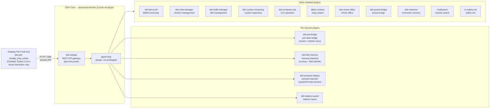

# DSH Self-Use Index

> **Languages:** English · [简体中文](README_ZH.md)

This repository is an **index** for a set of self-use development projects built on top of
[DeepSeek Harness (DSH)](https://github.com/deepseek-ai/deepseek-harness) — an all-plugin
Cordis agent harness. It does **not** contain the source of any sub-project; instead it
points to each sub-project's own repository so they can be developed and versioned
independently.

## Purpose

- Serve as a single entry point for all personal DSH-related development work.
- Keep an up-to-date catalog of sub-projects with links and short descriptions.
- Track project-level documents (under `docs/`) that span multiple sub-projects.

## Architecture

The desktop pet is the user-facing entry point. It talks to the DSH core over HTTP/SSE
through the `dsh-web-service` session API. The DSH core is an all-plugin Cordis harness —
every capability (including the agent loop) is a plugin. The pet-relevant plugins and the
other installed plugins are shown below.



### Plugin responsibilities

| Plugin | Role | Source |
| --- | --- | --- |
| dsh-pet-chubby_blue_whale | **Pet front-end** — visual interaction only (sprite, right-click menu, settings UI). No memory / persona / provider logic; all backend work delegated to DSH. | [Scorpioflz/dsh-pet-chubby_blue_whale](https://github.com/Scorpioflz/dsh-pet-chubby_blue_whale) |
| dsh-webapi | **REST API gateway** — exposes DSH sessions over HTTP/SSE; the pet's only entry point into DSH. | [toddpan/dsh-webapi](https://github.com/toddpan/dsh-webapi) |
| dsh-pet-bridge | **Pet state bridge** — syncs pet screen/window state between front-end and DSH. | local (pet integrations/) |
| dsh-fish-memory | **Memory backend** — scoring formula `P = C × (baseline + activation·A + importance·I + emotion·E)`, 30-day half-life, long-term facts pinned, injected via `systemPrompt.context`. | [Yuuyuko-uu/dsh-fish-memory](https://github.com/Yuuyuko-uu/dsh-fish-memory) |
| dsh-persona-dafeiyu | **Persona injection** — injects character persona via `systemPrompt.section()`; replaces the pet's former front-end persona splicing. | local (planned) |
| dsh-balance-panel | **Balance query** — API balance / quota panel. | [wycto/dsh-balance-panel](https://github.com/wycto/dsh-balance-panel) |
| dsh-bili-scroll | Bilibili scroll duty task. | [c1overzz/dsh-bili-scroll](https://github.com/c1overzz/dsh-bili-scroll) |
| dsh-chat-manager | Session management. | [WSL043/dsh-chat-manager](https://github.com/WSL043/dsh-chat-manager) |
| dsh-skills-manager | Skill management. | [MichengAI/dsh-skills-manager](https://github.com/MichengAI/dsh-skills-manager) |
| dsh-custom-reasoning | Custom reasoning. | [3likofj/dsh-custom-reasoning](https://github.com/3likofj/dsh-custom-reasoning) |
| dsh-computer-use | GUI operation (mouse / keyboard / screen). | [ltmroberthk915/dsh-computer-use](https://github.com/ltmroberthk915/dsh-computer-use) |
| billion-context | Long-context handling. | [ranxianglei/billion-context](https://github.com/ranxianglei/billion-context) |
| dsh-univer-office | Univer office integration. | [dream-num/dsh-univer-office](https://github.com/dream-num/dsh-univer-office) |
| dsh-preset-bridge | Preset bridge. | [Lyrissonare/dsh-preset-bridge](https://github.com/Lyrissonare/dsh-preset-bridge) |
| dsh-mnemon | Mnemonic memory. | [omdsh-dev/dsh-mnemon](https://github.com/omdsh-dev/dsh-mnemon) |
| modsearch | Module search. | [liustack/modsearch](https://github.com/liustack/modsearch) |
| cc-safety-net | Safety net. | [kenryu42/cc-safety-net](https://github.com/kenryu42/cc-safety-net) |

> The pet front-end is intentionally thin: **visual interaction only**. Memory, persona,
> provider routing, and web search have all been moved out of the pet into DSH plugins
> (see `docs/task1-pet-memory-simplification.md`).

## Sub-projects

> Each sub-project lives in its own folder under the workspace root and is an independent
> git repository. The folders themselves are git-ignored here — only this index repo and
> `docs/` are tracked.

| Name | Description | Repository |
| --- | --- | --- |
| dsh-pet-chubby_blue_whale | Desktop pet front-end for DSH (PySide6, Python 3.14+). Talks to DSH via the `dsh-web-service` session API. | [Scorpioflz/dsh-pet-chubby_blue_whale](https://github.com/Scorpioflz/dsh-pet-chubby_blue_whale) |

> When a new sub-project is added, append a row to the table above and add its folder
> to `.gitignore`.

## Workspace layout

```
DSH-Dev/                       # this index repo
├── README.md                  # this file (English)
├── README_ZH.md               # Chinese version
├── .gitignore
├── docs/                      # cross-project design notes and task docs
├── _plugin-references/        # shallow clones of installed DSH plugins (read-only, ignored)
├── deepseek-harness/          # upstream DSH source (read-only, ignored)
└── dsh-pet-chubby_blue_whale/ # desktop pet front-end (independent repo, ignored)
```

## References

- DSH upstream: [deepseek-ai/deepseek-harness](https://github.com/deepseek-ai/deepseek-harness)
- Installed plugin sources used as reference are listed in `docs/DSH Reference Record.md`.