# DSH 自用开发索引

> **语言：** [English](README.md) · 简体中文

本仓库是一套基于 [DeepSeek Harness (DSH)](https://github.com/deepseek-ai/deepseek-harness)
（all-plugin Cordis agent harness）的自用相关开发项目的**索引**。它**不包含**任何子项目的
源代码，而是指向各子项目各自的仓库，使其可以独立开发与版本管理。

## 用途

- 作为所有个人 DSH 相关开发工作的统一入口。
- 维护子项目清单，提供链接与简要说明。
- 跟踪跨子项目的项目级文档（位于 `docs/`）。

## 整体架构

桌宠是面向用户的入口，通过 `dsh-web-service` 会话 API 经 HTTP/SSE 接入 DSH 核心。DSH 核心是
all-plugin Cordis harness——每个能力（含 agent loop）都是插件。下图反映 `web` profile
（`~/.dsh/profiles/web/`）中**实际启用的插件**，以及 `_plugin-references/` 下仅参考/已弃的插件。

```mermaid
flowchart LR
    Pet["桌宠前端<br/>dsh-pet-chubby_blue_whale<br/>(PySide6, Python 3.14+)<br/>仅视觉交互"]

    subgraph Core ["DSH 核心 — deepseek-harness (Cordis all-plugin)"]
        direction TB
        Web["dsh-web-service<br/>(dsh-webapi) REST API 网关<br/>桌宠接入点"]
        AgentLoop["agent-loop<br/>(插件，非特权)"]
    end

    subgraph SelfDev ["自研插件（独立仓库）"]
        direction TB
        PetMemory["@dsh-cbw/memory<br/>记忆后端<br/>(基于 fish-memory 衍生:<br/>打分 + 半衰期 + P0-P3 升级)"]
    end

    subgraph Inherited ["继承插件（来自 MerZlin/dsh-pet-indesktop）"]
        direction TB
        PetBridge["@dsh-pet/bridge<br/>桌宠状态桥接<br/>(屏幕/窗口同步)"]
    end

    subgraph InUse ["在用的第三方插件（web profile）"]
        direction TB
        Persona["dsh-persona-dafeiyu<br/>人设注入<br/>(systemPrompt.section, v0.7.1)"]
        Balance["@wycto/dsh-balance-panel<br/>余额查询"]
        Bili["dsh-bili-scroll<br/>B站滚动任务"]
        ChatMgr["dsh-chat-manager<br/>会话管理"]
        Skills["@michengai/dsh-skills-manager<br/>技能管理"]
        Reason["dsh-custom-reasoning<br/>自定义推理"]
        CompUse["dsh-codex-style-computer-use<br/>GUI 操作"]
        BigCtx["billion-context<br/>长上下文 / 存储"]
        Univer["dsh-univer-office<br/>Univer 办公"]
        Preset["dsh-preset-bridge<br/>预设桥接"]
        ModSearch["@liustack/modsearch<br/>模块搜索"]
        Safety["cc-safety-net<br/>安全网"]
        Market["dshmarket<br/>插件市场"]
    end

    subgraph RefOnly ["仅参考 / 已弃（在 _plugin-references，未启用）"]
        direction TB
        FishMem["dsh-fish-memory<br/>→ 被 @dsh-cbw/memory 替代<br/>(保留作参考源)"]
        Mnemon["dsh-mnemon<br/>→ 与 @dsh-cbw/memory 冲突"]
        OldComp["dsh-computer-use<br/>→ 被 dsh-codex-style-computer-use 替代"]
        PromptPersona["dsh-prompt-persona<br/>→ 被 dsh-persona-dafeiyu 替代"]
        WhalePersona["dsh-whale-musume-persona<br/>→ 人设候选，未启用"]
        Soul["dsh-soul<br/>→ 评估后未整合"]
        PetUpstream["dsh-pet-indesktop-upstream<br/>→ 桌宠上游参考 (MerZlin)"]
        Hermes["hermes-pet-bridge<br/>→ 在 integrations/，未启用"]
    end

    Pet -- "HTTP / SSE<br/>会话 API" --> Web
    Web --> AgentLoop
    AgentLoop --> SelfDev
    AgentLoop --> Inherited
    AgentLoop --> InUse
```



### 各插件职责

状态列：**在用** = 在 `web` profile 启用；**参考** = 在 `_plugin-references/` 浅克隆仅参考；
**已弃** = 被其他插件替代。

| 插件 | 职责 | 状态 | 来源 |
| --- | --- | --- | --- |
| dsh-pet-chubby_blue_whale | **桌宠前端** — 仅做视觉交互（精灵图、右键菜单、设置 UI）。不含记忆/人设/provider 逻辑，全部后端工作交由 DSH。 | 在用 | [Scorpioflz/dsh-pet-chubby_blue_whale](https://github.com/Scorpioflz/dsh-pet-chubby_blue_whale) |
| dsh-web-service (dsh-webapi) | **REST API 网关** — 经 HTTP/SSE 暴露 DSH 会话；桌宠接入 DSH 的唯一入口。 | 在用 | [toddpan/dsh-webapi](https://github.com/toddpan/dsh-webapi) |
| @dsh-pet/bridge | **桌宠状态桥接**（继承自 [MerZLin/dsh-pet-indesktop](https://github.com/MerZLin/dsh-pet-indesktop)）— 在前端与 DSH 间同步桌宠屏幕/窗口状态。 | 在用 | 本地（桌宠 `integrations/dsh-pet-bridge/`） |
| @dsh-cbw/memory | **记忆后端**（自研，基于 dsh-fish-memory 衍生）— 按工作区隔离的记忆，打分 + 半衰期 + P0-P3 升级（请求检测、bigram 去重、recall 工具、自动归档、来源标记、JSONL+category、定时沉淀、安全模型、归档索引、CJK bigram），经 `systemPrompt.context` 注入。 | 在用 | [Scorpioflz/dsh-cbw-memory](https://github.com/Scorpioflz/dsh-cbw-memory) |
| dsh-persona-dafeiyu | **人设注入** — 经 `systemPrompt.section()` 注入角色人设；替代桌宠原前端人设拼接。使用上游第三方插件（v0.7.1），已放弃自研人设插件，改为配合自写的人设模板（见 `docs/大肥鱼_蓝鲸女仆人设模板.md`）。 | 在用 | [huaizhuanghub/dsh-persona-dafeiyu](https://github.com/huaizhuanghub/dsh-persona-dafeiyu) |
| @wycto/dsh-balance-panel | 余额/额度查询面板。 | 在用 | [wycto/dsh-balance-panel](https://github.com/wycto/dsh-balance-panel) |
| dsh-bili-scroll | B站滚动任务。 | 在用 | [c1overzz/dsh-bili-scroll](https://github.com/c1overzz/dsh-bili-scroll) |
| dsh-chat-manager | 会话管理。 | 在用 | [WSL043/dsh-chat-manager](https://github.com/WSL043/dsh-chat-manager) |
| @michengai/dsh-skills-manager | 技能管理。 | 在用 | [MichengAI/dsh-skills-manager](https://github.com/MichengAI/dsh-skills-manager) |
| dsh-custom-reasoning | 自定义推理。 | 在用 | [3likofj/dsh-custom-reasoning](https://github.com/3likofj/dsh-custom-reasoning) |
| dsh-codex-style-computer-use | GUI 操作（鼠标/键盘/屏幕）。 | 在用 | （npm 包，无本地参考克隆） |
| billion-context | 长上下文 / 存储核心。 | 在用 | [ranxianglei/billion-context](https://github.com/ranxianglei/billion-context) |
| dsh-univer-office | Univer 办公集成。 | 在用 | [dream-num/dsh-univer-office](https://github.com/dream-num/dsh-univer-office) |
| dsh-preset-bridge | 预设桥接。 | 在用 | [Lyrissonare/dsh-preset-bridge](https://github.com/Lyrissonare/dsh-preset-bridge) |
| @liustack/modsearch | 模块搜索。 | 在用 | [liustack/modsearch](https://github.com/liustack/modsearch) |
| cc-safety-net | 安全网 / 命令门控。 | 在用 | [kenryu42/cc-safety-net](https://github.com/kenryu42/cc-safety-net) |
| dshmarket | 插件市场。 | 在用 | （npm 包，无本地参考克隆） |
| dsh-fish-memory | 记忆后端（打分 + 30 天半衰期）。**是 @dsh-cbw/memory 的参考源**，未在 profile 安装。 | 参考 / 已弃 | [Yuuyuko-uu/dsh-fish-memory](https://github.com/Yuuyuko-uu/dsh-fish-memory) |
| dsh-mnemon | 助记记忆。与 @dsh-cbw/memory 冲突，未启用。 | 参考 / 已弃 | [omdsh-dev/dsh-mnemon](https://github.com/omdsh-dev/dsh-mnemon) |
| dsh-computer-use | GUI 操作。被 dsh-codex-style-computer-use 替代。 | 参考 / 已弃 | [ltmroberthk915/dsh-computer-use](https://github.com/ltmroberthk915/dsh-computer-use) |
| dsh-prompt-persona | 人设注入。被 dsh-persona-dafeiyu 替代。 | 参考 / 已弃 | （_plugin-references/dsh-prompt-persona） |
| dsh-whale-musume-persona | 人设候选，未启用。 | 参考 | （_plugin-references/dsh-whale-musume-persona） |
| dsh-soul | 2026-10-29 评估后未整合（仅借鉴骨架思路）。 | 参考 | （_plugin-references/dsh-soul） |
| dsh-pet-indesktop-upstream | 桌宠上游参考（MerZlin/dsh-pet-indesktop, MIT）。 | 参考 | （_plugin-references/dsh-pet-indesktop-upstream） |
| hermes-pet-bridge | 桌宠桥接变体，在 integrations/ 但未在 profile 启用。 | 参考 / 已弃 | 本地（桌宠 `integrations/hermes-pet-bridge/`） |

> 桌宠前端刻意保持精简：**仅做视觉交互**。记忆、人设、provider 路由、联网搜索均已从桌宠
> 移入 DSH 插件（见 `docs/proposal-memory-plugin-upgrade.md` §七）。`_plugin-references/` 存放
> 在用与仅参考插件的浅克隆——**出现在该目录不等于插件已启用**。权威来源是 `web` profile 的
> `cordis.patch.yml` + `package.json` bundles。

## 子项目

> 每个子项目位于工作区根目录下各自的文件夹中，是独立的 git 仓库。这些文件夹在本索引
> 仓库中被 git-ignore，仅本索引仓库与 `docs/` 被跟踪。
>
> **分片文档**：各子项目的详细描述放在 `docs/sub-projects/<name>.md`。更新子项目时
> **只改自己的分片**——不碰 README 主体或其他分片。这样多会话并行开发不同子项目时不会冲突。

| 名称 | 说明 | 仓库 | 详情 |
| --- | --- | --- | --- |
| dsh-pet-chubby_blue_whale | DSH 桌宠前端（PySide6，Python 3.14+），通过 `dsh-web-service` 会话 API 接入 DSH。 | [Scorpioflz/dsh-pet-chubby_blue_whale](https://github.com/Scorpioflz/dsh-pet-chubby_blue_whale) | [分片](docs/sub-projects/dsh-pet-chubby_blue_whale.md) |
| dsh-cbw-memory | DSH 长期记忆插件（半衰期衰减、情感加权、按工作区隔离共享）。基于 Yuuyuko-uu/dsh-fish-memory 衍生。 | [Scorpioflz/dsh-cbw-memory](https://github.com/Scorpioflz/dsh-cbw-memory) | [分片](docs/sub-projects/dsh-cbw-memory.md) |

> 新增子项目时：在上表追加一行，创建 `docs/sub-projects/<name>.md`，并将其文件夹加入 `.gitignore`。

## 工作区结构

```
DSH-Dev/                       # 本索引仓库
├── README.md                  # 英文说明
├── README_ZH.md               # 中文说明（本文件）
├── .gitignore
├── docs/                      # 跨子项目的设计与任务文档
├── _plugin-references/        # DSH 插件浅克隆（在用 + 仅参考，已忽略）
├── deepseek-harness/          # DSH 上游源码（只读，已忽略）
├── dsh-cbw-memory/            # DSH 记忆插件（独立仓库，已忽略）
└── dsh-pet-chubby_blue_whale/ # 桌宠前端（独立仓库，已忽略）
```

## 参考

- DSH 上游：[deepseek-ai/deepseek-harness](https://github.com/deepseek-ai/deepseek-harness)
- 作为参考的已安装插件源码清单见 `docs/DSH Reference Record.md`。
- 插件更新每天跟踪：`docs/plugin_updates.md`（由 `scripts/check_plugin_updates.py` 自动维护）。- 桌宠人设模板（自写，喂给 `dsh-persona-dafeiyu`）：`docs/大肥鱼_蓝鲸女仆人设模板.md` ——「大肥鱼 / 蓝鲸女仆」角色卡，含社区共识区 + 自定义留白区。