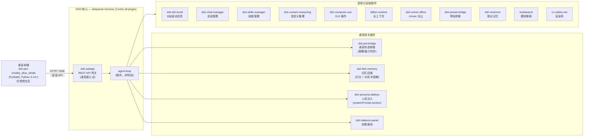

# DSH 自用开发索引

> **语言：** [English](README.md) · 简体中文

本仓库是一套基于 [DeepSeek Harness (DSH)](https://github.com/deepseek-ai/deepseek-harness)
（all-plugin Cordis agent harness）的自用相关开发项目的**索引**。它**不包含**任何子项目的
源代码，而是指向各子项目各自的仓库，使其可以独立开发与版本管理。

## 用途

- 作为所有个人 DSH 相关开发工作的统一入口。
- 维护子项目清单，提供链接与简要说明。
- 跟踪跨子项目的项目级文档（位于 `docs/`）。

## 整体架构

桌宠是面向用户的入口，通过 `dsh-web-service` 会话 API 经 HTTP/SSE 接入 DSH 核心。DSH 核心是
all-plugin Cordis harness——每个能力（含 agent loop）都是插件。下图展示桌宠相关插件与其他已
安装插件。



### 各插件职责

| 插件 | 职责 | 来源 |
| --- | --- | --- |
| dsh-pet-chubby_blue_whale | **桌宠前端** — 仅做视觉交互（精灵图、右键菜单、设置 UI）。不含记忆/人设/provider 逻辑，全部后端工作交由 DSH。 | [Scorpioflz/dsh-pet-chubby_blue_whale](https://github.com/Scorpioflz/dsh-pet-chubby_blue_whale) |
| dsh-webapi | **REST API 网关** — 经 HTTP/SSE 暴露 DSH 会话；桌宠接入 DSH 的唯一入口。 | [toddpan/dsh-webapi](https://github.com/toddpan/dsh-webapi) |
| dsh-pet-bridge | **桌宠状态桥接** — 在前端与 DSH 间同步桌宠屏幕/窗口状态。 | 本地（pet integrations/） |
| dsh-fish-memory | **记忆后端** — 打分公式 `P = C × (baseline + activation·A + importance·I + emotion·E)`，30 天半衰期，长期事实常驻，经 `systemPrompt.context` 注入。 | [Yuuyuko-uu/dsh-fish-memory](https://github.com/Yuuyuko-uu/dsh-fish-memory) |
| dsh-persona-dafeiyu | **人设注入** — 经 `systemPrompt.section()` 注入角色人设；替代桌宠原前端人设拼接。 | 本地（规划中） |
| dsh-balance-panel | **余额查询** — API 余额/额度面板。 | [wycto/dsh-balance-panel](https://github.com/wycto/dsh-balance-panel) |
| dsh-bili-scroll | B站滚动任务。 | [c1overzz/dsh-bili-scroll](https://github.com/c1overzz/dsh-bili-scroll) |
| dsh-chat-manager | 会话管理。 | [WSL043/dsh-chat-manager](https://github.com/WSL043/dsh-chat-manager) |
| dsh-skills-manager | 技能管理。 | [MichengAI/dsh-skills-manager](https://github.com/MichengAI/dsh-skills-manager) |
| dsh-custom-reasoning | 自定义推理。 | [3likofj/dsh-custom-reasoning](https://github.com/3likofj/dsh-custom-reasoning) |
| dsh-computer-use | GUI 操作（鼠标/键盘/屏幕）。 | [ltmroberthk915/dsh-computer-use](https://github.com/ltmroberthk915/dsh-computer-use) |
| billion-context | 长上下文处理。 | [ranxianglei/billion-context](https://github.com/ranxianglei/billion-context) |
| dsh-univer-office | Univer 办公集成。 | [dream-num/dsh-univer-office](https://github.com/dream-num/dsh-univer-office) |
| dsh-preset-bridge | 预设桥接。 | [Lyrissonare/dsh-preset-bridge](https://github.com/Lyrissonare/dsh-preset-bridge) |
| dsh-mnemon | 助记记忆。 | [omdsh-dev/dsh-mnemon](https://github.com/omdsh-dev/dsh-mnemon) |
| modsearch | 模块搜索。 | [liustack/modsearch](https://github.com/liustack/modsearch) |
| cc-safety-net | 安全网。 | [kenryu42/cc-safety-net](https://github.com/kenryu42/cc-safety-net) |

> 桌宠前端刻意保持精简：**仅做视觉交互**。记忆、人设、provider 路由、联网搜索均已从桌宠
> 移入 DSH 插件（见 `docs/task1-pet-memory-simplification.md`）。

## 子项目

> 每个子项目位于工作区根目录下各自的文件夹中，是独立的 git 仓库。这些文件夹在本索引
> 仓库中被 git-ignore，仅本索引仓库与 `docs/` 被跟踪。

| 名称 | 说明 | 仓库 |
| --- | --- | --- |
| dsh-pet-chubby_blue_whale | DSH 桌宠前端（PySide6，Python 3.14+），通过 `dsh-web-service` 会话 API 接入 DSH。 | [Scorpioflz/dsh-pet-chubby_blue_whale](https://github.com/Scorpioflz/dsh-pet-chubby_blue_whale) |

> 新增子项目时，在上表追加一行，并将其文件夹加入 `.gitignore`。

## 工作区结构

```
DSH-Dev/                       # 本索引仓库
├── README.md                  # 英文说明
├── README_ZH.md               # 中文说明（本文件）
├── .gitignore
├── docs/                      # 跨子项目的设计与任务文档
├── _plugin-references/        # 已安装 DSH 插件的浅克隆源码（只读，已忽略）
├── deepseek-harness/          # DSH 上游源码（只读，已忽略）
└── dsh-pet-chubby_blue_whale/ # 桌宠前端（独立仓库，已忽略）
```

## 参考

- DSH 上游：[deepseek-ai/deepseek-harness](https://github.com/deepseek-ai/deepseek-harness)
- 作为参考的已安装插件源码清单见 `docs/DSH Reference Record.md`。